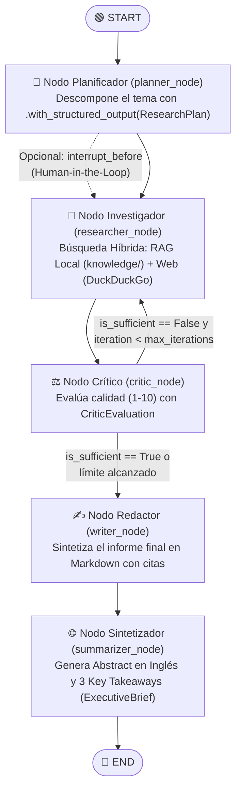

# 🧠 Deep Research Agent — LangChain + LangGraph + Google Gemini


Agente autónomo de **Investigación Profunda con Ciclo de Reflexión (Self-Reflective Deep Research Agent)** construido con **LangChain**, **LangGraph** y **Google Gemini**.

A diferencia de un chatbot tradicional que responde en un solo paso, este agente **planifica** sub-consultas, **investiga** combinando **Base de Conocimiento Local (RAG)** y **Búsqueda Web**, **audita críticamente** la calidad de sus hallazgos y, si detecta vacíos de información, **se auto-corrige iterando nuevas búsquedas** antes de redactar un informe técnico en Markdown y un **Executive Brief bilingüe**.

---

## 🗺️ Arquitectura del Grafo (`StateGraph`)



---

## ✨ Características Principales

- **Orquestación Cíclica con `LangGraph`**: Uso de `StateGraph`, reductores `Annotated[list, operator.add]` y bordes condicionales (`add_conditional_edges`).
- **Salidas Estructuradas (`Pydantic`)**: Los nodos `planner_node`, `critic_node` y `summarizer_node` utilizan `.with_structured_output()` para garantizar contratos de datos estrictos.
- **Agentic RAG Híbrido (`knowledge/` + Web)**: Combina documentos locales verificados (`knowledge/arquitectura_agentes.md`) con búsquedas web en vivo mediante `ddgs`.
- **Soporte para Human-in-the-Loop (`interrupt_before`)**: Permite pausar el grafo tras la planificación (`interrupt_before_research=True`), editar las consultas con `graph.update_state()` y reanudar la ejecución.
- **Modo Real + Modo Demo / Educativo**: Funciona conectado a **Google Gemini** (`GOOGLE_API_KEY`) o en **Modo Demo** instantáneo (sin requerir API key) para pruebas rápidas y CI/CD.
- **Triple Interfaz**:
  1. **App Web Interactiva (`Streamlit`)**: Streaming en vivo de cada nodo del grafo y descarga del reporte `.md`.
  2. **CLI en Terminal (`Rich`)**: Ejecución por consola con paneles formateados.
  3. **Compatible con `LangGraph Studio`**: Incluye `langgraph.json`.
- **Repositorio AI-First (Antigravity Ready)**: Incluye [`AGENTS.md`](./AGENTS.md), `.agents/skills/add-langgraph-node/SKILL.md` y la [**Guía Maestra para Ingeniero de IA**](./docs/GUIA_INGENIERO_IA_LANGGRAPH.md).

---

## 📂 Estructura del Proyecto

```text
├── .agents/
│   └── skills/
│       └── add-langgraph-node/
│           └── SKILL.md                  # Skill para extender el grafo con Antigravity
├── docs/
│   └── GUIA_INGENIERO_IA_LANGGRAPH.md    # Guía paso a paso de LangChain/LangGraph y Roadmap IA
├── knowledge/
│   └── arquitectura_agentes.md           # Base de conocimiento local para Agentic RAG
├── src/
│   └── deep_research/
│       ├── state.py                      # ResearchState (TypedDict) y esquemas Pydantic
│       ├── prompts.py                    # Prompts del sistema para cada nodo especialista
│       ├── tools.py                      # Herramienta híbrida: RAG Local + DuckDuckGo
│       ├── nodes.py                      # Nodos: Planner, Researcher, Critic, Writer y Summarizer
│       └── graph.py                      # Compilación del StateGraph, MemorySaver y HITL
├── tests/
│   └── test_graph.py                     # Suite de 4 tests (Routing, Local RAG, Reflection y HITL)
├── app.py                                # Interfaz web con Streamlit
├── cli.py                                # Interfaz de línea de comandos con Rich
├── langgraph.json                        # Configuración para LangGraph Studio
├── AGENTS.md                             # Reglas de contexto e ingeniería del proyecto
├── .env.example                          # Plantilla de variables de entorno
└── requirements.txt                      # Dependencias del proyecto
```

---

## 🚀 Instalación y Uso Rápido

### 1. Crear y activar el entorno virtual
```powershell
python -m venv .venv
.\.venv\Scripts\Activate.ps1
pip install -r requirements.txt
```

### 2. Configurar tu API Key de Google Gemini (Opcional para Modo Demo)
Copia el archivo `.env.example` a `.env` y agrega tu clave gratuita de [Google AI Studio](https://aistudio.google.com/apikey):
```powershell
Copy-Item .env.example .env
```

### 3. Ejecutar la Interfaz Web (Streamlit)
```powershell
.\.venv\Scripts\streamlit.exe run app.py
```

### 4. Ejecutar desde la Terminal (CLI)
```powershell
# Ejecución rápida en Modo Demo (sin requerir API key):
.\.venv\Scripts\python.exe cli.py --topic "Arquitecturas Multi-Agente con LangGraph" --mock

# Ejecución real con Google Gemini y guardado de reporte:
.\.venv\Scripts\python.exe cli.py --topic "RAG Agéntico en Producción" --max-iterations 2 --output reporte.md
```

### 5. Ejecutar las Pruebas Automatizadas (`pytest`)
```powershell
.\.venv\Scripts\pytest.exe -v
```

---

## 🎓 Guía de Estudio Incluida
Consulta [`docs/GUIA_INGENIERO_IA_LANGGRAPH.md`](./docs/GUIA_INGENIERO_IA_LANGGRAPH.md) para aprender paso a paso cada concepto de este repositorio y seguir la hoja de ruta completa para convertirte en **Ingeniero de IA**.
