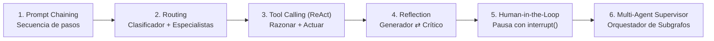

# 🎓 Guía Maestra: De Cero a Ingeniero de IA con LangChain, LangGraph y Antigravity

Esta guía está diseñada como tu manual de referencia definitivo para comprender a fondo cómo funcionan **LangChain** y **LangGraph**, cómo se conectan en nuestro proyecto **Deep Research Agent**, y cuál es la hoja de ruta completa (con recursos gratuitos, cursos oficiales, libros y proyectos) para convertirte en un **AI Engineer (Ingeniero de Inteligencia Artificial)** de nivel profesional.

---

## Parte 1: Entendiendo la Diferencia entre LangChain y LangGraph

Muchos desarrolladores que empiezan confunden ambos frameworks. Piénsalo así:

| Característica | 🔗 **LangChain** | 🕸️ **LangGraph** |
| :--- | :--- | :--- |
| **Propósito Principal** | Bloques de construcción estándar para interactuar con LLMs. | Orquestación de agentes con estado, ciclos, memoria y decisiones dinámicas. |
| **Estructura Mental** | Cadenas lineales o DAGs (`Prompt -> LLM -> Parser`). | Grafos con ciclos (`StateGraph`: Nodos + Bordes + Estado compartido). |
| **Componentes que usamos** | `ChatGoogleGenerativeAI`, `SystemMessage`, `HumanMessage`, `@tool`, `.with_structured_output()`. | `StateGraph`, `START`, `END`, `Annotated[list, operator.add]`, `add_conditional_edges`, `MemorySaver`. |
| **Cuándo usarlo solo** | Tareas de un solo paso: resumir un texto, extraer JSON de una factura, clasificar un correo. | Sistemas agénticos reales: investigadores autónomos, copilotos con revisión humana, equipos multi-agente. |

> [!IMPORTANT]
> **Regla de oro moderna:** Usa **LangChain** para hablar con el modelo y definir herramientas individualmente; usa **LangGraph** para controlar el flujo, los bucles de reflexión y la memoria del agente.

---

## Parte 2: Los 5 Pilares de LangGraph Paso a Paso (Con el Código de este Proyecto)

### Pilar 1: El Estado Compartido (`State`) y Reductores (`Reducers`)
En LangGraph, todos los nodos leen y escriben en un diccionario tipado llamado `State`.
- **Sobrescritura simple:** Si defines `quality_score: int`, cuando un nodo devuelve `{"quality_score": 9}`, reemplaza el valor anterior.
- **Acumulación con `Annotated` y `operator.add`:** Si quieres que una lista **acumule** elementos entre distintas iteraciones sin borrar los anteriores (por ejemplo, todos los hallazgos web), usas un *reducer*:

```python
import operator
from typing import Annotated, TypedDict

class ResearchState(TypedDict):
    topic: str                                        # Se sobrescribe
    findings: Annotated[list[dict], operator.add]     # Se ACUMULA (concatena listas)
```
👉 *Ver implementación real en:* [`src/deep_research/state.py`](../src/deep_research/state.py)

---

### Pilar 2: Salidas Estructuradas (`.with_structured_output`) con Pydantic
Un Ingeniero de IA **nunca** confía en parsear texto libre con expresiones regulares frágiles cuando necesita que un agente tome decisiones de flujo. Usamos esquemas `Pydantic`:

```python
from pydantic import BaseModel, Field

class CriticEvaluation(BaseModel):
    quality_score: int = Field(ge=1, le=10, description="Calificación de 1 a 10")
    is_sufficient: bool = Field(description="True si ya podemos redactar el informe")
    follow_up_queries: list[str] = Field(default_factory=list)

# LangChain obliga a Gemini a responder exactamente con este esquema tipado:
structured_critic = llm.with_structured_output(CriticEvaluation)
evaluation = structured_critic.invoke(messages)
```
👉 *Ver implementación real en:* [`src/deep_research/nodes.py`](../src/deep_research/nodes.py)

---

### Pilar 3: Los Nodos (`Nodes`)
Un nodo es una función pura de Python que recibe `state: ResearchState` y devuelve **únicamente las claves que quiere modificar**:

```python
def planner_node(state: ResearchState) -> dict:
    topic = state["topic"]
    # ... llama al LLM estructurado ...
    return {
        "research_goal": plan.research_goal,
        "current_queries": plan.sub_queries,
        "iteration": 0,
    }
```

---

### Pilar 4: Bordes Condicionales (`Conditional Edges`) y Ciclos de Reflexión
Lo que convierte a un flujo lineal en un **verdadero agente** es su capacidad de **autoevaluarse y repetir un ciclo** si el resultado aún no es lo suficientemente bueno (Patrón *Reflection*):

```python
from typing import Literal

def should_continue_research(state: ResearchState) -> Literal["researcher", "writer"]:
    # SIEMPRE pon un límite máximo de iteraciones para evitar bucles infinitos
    if state["is_sufficient"] or state["iteration"] >= state["max_iterations"]:
        return "writer"
    return "researcher"
```

Y luego lo conectamos en el grafo:
```python
workflow.add_conditional_edges(
    "critic",                   # Nodo origen
    should_continue_research,   # Función que decide el destino
    {
        "researcher": "researcher",
        "writer": "writer",
    },
)
```
👉 *Ver implementación real en:* [`src/deep_research/graph.py`](../src/deep_research/graph.py)

---

### Pilar 5: Streaming y Memoria (`Checkpointers`)
- **`graph.invoke(state)`**: Ejecuta todo el grafo y espera hasta tener el resultado final.
- **`graph.stream(state, stream_mode="updates")`**: Emite un evento cada vez que un nodo termina su trabajo. Así es como nuestra interfaz en [`app.py`](../app.py) y [`cli.py`](../cli.py) muestran en vivo qué está pensando el agente.
- **`MemorySaver()`**: Guarda el estado de cada paso asociado a un `thread_id`. Permite pausar el grafo, pedir confirmación humana (*Human-in-the-Loop*) y continuar exactamente donde quedó.

---

## Parte 3: Los 6 Patrones de Diseño Agéntico que Todo Ingeniero de IA Debe Dominar



1. **Prompt Chaining**: Dividir una tarea grande en pasos secuenciales verificables.
2. **Routing (Enrutamiento)**: Un nodo clasifica la intención del usuario y envía el flujo al nodo experto correspondiente.
3. **Tool Calling / ReAct**: El LLM decide dinámicamente qué herramienta (`@tool`) invocar y con qué argumentos.
4. **Reflection / Self-Correction (El que construimos aquí)**: Un nodo *Crítico* audita la salida antes de entregarla al usuario y solicita correcciones.
5. **Human-in-the-Loop (HITL)**: Usar `interrupt()` de LangGraph para detener la ejecución antes de una acción sensible (ej. enviar un email, ejecutar SQL `DELETE`) hasta que un humano apruebe.
6. **Supervisor Multi-Agente**: Un agente jefe coordina subgrafos especializados (ej. Agente Programador + Agente QA + Agente Documentador).

---

## Parte 4: Hoja de Ruta Completa (Roadmap) para Convertirte en Ingeniero de IA

Para pasar de principiante a **AI Engineer Senior**, sigue este plan estructurado en 5 fases:

### Fase 1: Fundamentos de Ingeniería en Python para IA
- **Qué dominar:**
  - Tipado moderno en Python (`TypedDict`, `Annotated`, `Literal`, `Protocol`).
  - Validación de datos con **Pydantic v2** (`BaseModel`, `Field`, validadores).
  - Programación asíncrona (`async` / `await` con `asyncio`) y creación de APIs con **FastAPI**.
- **Ejercicio práctico:** Añade un validador Pydantic en [`src/deep_research/state.py`](../src/deep_research/state.py) que limpie espacios vacíos en las consultas.

### Fase 2: Dominio de LLMs, Prompt Engineering y Structured Outputs
- **Qué dominar:**
  - Roles de mensajes (`SystemMessage`, `HumanMessage`, `AIMessage`, `ToolMessage`).
  - Parámetros de generación (`temperature`, `top_p`, `max_tokens`, ventanas de contexto).
  - *Function Calling / Tool Calling* y *Structured Outputs*.
- **Material gratuito imprescindible:**
  - 📘 [Documentación Oficial de Google Gemini API](https://ai.google.dev/gemini-api/docs)
  - 🎓 [DeepLearning.AI Short Courses (Gratis)](https://www.deeplearning.ai/short-courses/) — especialmente *ChatGPT Prompt Engineering for Developers* y *Functions, Tools and Agents with LangChain*.

### Fase 3: RAG Avanzado y Bases de Datos Vectoriales (Agentic RAG)
- **Qué dominar:**
  - *Chunking* inteligente de documentos (Markdown, PDF, código).
  - *Embeddings* (representaciones vectoriales semánticas) y búsqueda híbrida (Vectorial + BM25/Keywords).
  - **Corrective RAG (CRAG) con LangGraph:** Combinar búsqueda en tus documentos locales con un nodo evaluador que, si no encuentra la respuesta en el PDF, sale a buscar a la web (¡exactamente como nuestro `researcher_node`!).
- **Herramientas estándar de la industria:** `Qdrant`, `ChromaDB`, `pgvector` (PostgreSQL).

### Fase 4: Arquitectura de Agentes con LangGraph (Tu Proyecto Actual)
- **Material oficial gratuito #1 del mundo para LangGraph:**
  - 🏆 **[LangChain Academy — Introduction to LangGraph (Gratis con certificado)](https://academy.langchain.com/courses/intro-to-langgraph)**: El curso oficial creado por los autores de LangGraph. Cubre `StateGraph`, `MemorySaver`, `Human-in-the-loop`, `Subgraphs` y despliegues.
  - 📖 **[Guía de Agentes de Anthropic: Building Effective Agents](https://www.anthropic.com/research/building-effective-agents)**: Lectura obligatoria de 15 minutos sobre cuándo usar flujos simples y cuándo usar agentes autónomos.
  - 💻 **[Repositorio de Tutoriales Oficiales de LangGraph](https://github.com/langchain-ai/langgraph/tree/main/docs/docs/tutorials)**: Ejemplos de Customer Support, Code Assistant, Self-RAG y Multi-Agent.

### Fase 5: Evaluación, Observabilidad (LLMOps) y Producción
Lo que separa a un hobbyist de un **Ingeniero de IA contratado en empresas top** es saber **medir y monitorear** sus agentes:
- **Observabilidad y Trazas:** Conecta **LangSmith** (capa gratuita en [smith.langchain.com](https://smith.langchain.com/)) descomenta las 3 líneas de `LANGSMITH_*` en tu archivo `.env` y podrás ver cada llamada a Gemini, latencia, tokens consumidos y estado del grafo en una interfaz visual.
- **Evaluación Automática (Evals):** Uso de *LLM-as-a-Judge* y frameworks como **Ragas** o **LangSmith Evals** para medir alucinaciones, relevancia y fidelidad antes de pasar a producción.

---

## Parte 5: Libros y Recursos de Cabecera Recomendados

1. 📚 **_AI Engineering: Building Applications with Foundation Models_** — *Chip Huyen (O'Reilly, 2025)*: El libro de referencia más completo de la industria sobre arquitectura de sistemas con LLMs, RAG, agentes, evaluación y optimización de costos/latencia.
2. 📚 **_LLM Engineer's Handbook_** — *Paul Iusztin & Maxime Labonne (Packt)*: Guía práctica de extremo a extremo desde la ingesta de datos hasta producción.
3. 🎥 **[Canal de YouTube oficial de LangChain](https://www.youtube.com/@LangChain)**: Videos cortos semanales explicando patrones como *Plan-and-Execute*, *Reflexion*, *Storm* y *Ambient Agents*.

---

## Parte 6: Retos Prácticos en este Repositorio (Aprende Haciendo con Antigravity)

Para afianzar todo lo aprendido, prueba pedirle a **Antigravity** en el chat cualquiera de estas evoluciones usando los comandos que aprendiste:

1. **Reto 1 — Usar un Skill propio:**
   > Escribe en el chat: *"Usando el skill `add-langgraph-node`, agrega un nodo `translator_node` al final del grafo que traduzca un resumen ejecutivo al inglés."*
2. **Reto 2 — Human-in-the-Loop (`/plan`):**
   > Escribe en el chat: *"`/plan` Quiero agregar una pausa `interrupt` después del `planner_node` para que el usuario pueda editar las consultas antes de que el `researcher_node` busque en internet."*
3. **Reto 3 — Exportación a PDF o Búsqueda Local RAG (`/boost`):**
   > Escribe en el chat: *"`/boost` Agrega una herramienta adicional en `@src/deep_research/tools.py` que también permita leer archivos `.txt` o `.md` de una carpeta `knowledge/` local."*
